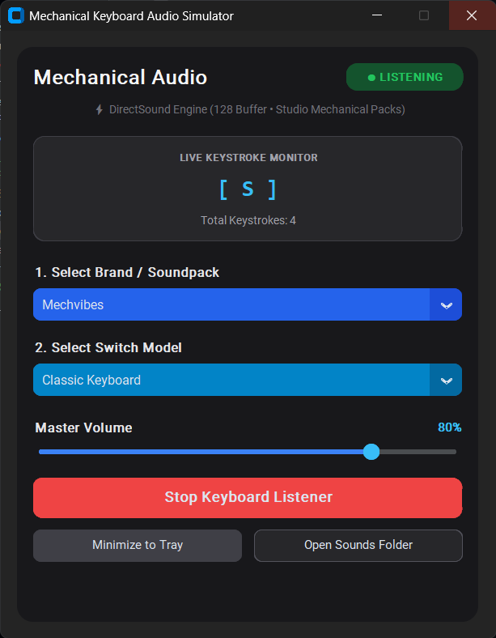

# ⌨️ Mechanical Keyboard Audio Simulator

[](https://www.python.org/)
[](LICENSE)
[](https://www.microsoft.com/windows)
[](CONTRIBUTING.md)

A lightweight Windows desktop app that plays **authentic mechanical keyboard sounds** every time you type — across any application. Choose from multiple brands and switch models, adjust the volume, and let it run silently in the system tray.

---

## ✨ Features

- 🎧 **Global keyboard listener** — plays sounds for every keystroke, system-wide
- 🔊 **Sub-5ms ultra-low latency** playback via `pygame.mixer` (128 buffer, 64 channels)
- 🎹 **Per-key sound mapping** — character-specific recordings (a.wav, b.wav, etc.) when available
- 🎚️ **Stabilizer audio** — distinct sounds for Space, Enter, Backspace, and Shift
- 📦 **Multiple soundpacks** — Cherry MX, Drop Holy Panda, NovelKeys Cream, ZealPC Tealios, Mechvibes, and more
- 🔄 **Cascading brand & model selectors** — pick your brand, then your switch
- 🔉 **Volume control** with live percentage display
- ⌨️ **Live keystroke monitor** — see the last key pressed and total keystroke count
- 🖥️ **System tray support** — minimize to tray, toggle listener, or exit from the tray menu
- 🎨 **Modern dark UI** built with CustomTkinter
- 🔒 **Privacy-first** — does not record, log, or transmit any keystrokes

> **Privacy Note:** The app uses a global keyboard hook to trigger sounds. It does **not** suppress, record, or store any key input. Pause the listener from the app when you don't need it.

---

## 📸 Screenshots

<p align="center">
  
</p>

---

## 🚀 Quick Start

### Prerequisites

- **Windows 10** or later
- **Python 3.10+** ([Download here](https://www.python.org/downloads/))
  > ⚠️ During installation, make sure to check **"Add Python to PATH"**
- An audio output device (speakers/headphones)

### Option 1: Double-click to run (recommended)

1. **Clone or download** this repository:
   ```bash
   git clone https://github.com/Shashank163007/Mechanical-Keyboard.git
   cd Mechanical-Keyboard
   ```
2. **Double-click `run.bat`**

   That's it! On the first run, the script will automatically:
   - Create a Python virtual environment (`.venv`)
   - Install all required dependencies
   - Launch the app

### Option 2: Manual setup via terminal

```powershell
# Clone the repo
git clone https://github.com/Shashank163007/Mechanical-Keyboard.git
cd Mechanical-Keyboard

# Create and activate virtual environment
python -m venv .venv
.venv\Scripts\Activate.ps1

# Install dependencies
pip install -r requirements.txt

# Run the app
python main.py
```

> **PowerShell tip:** If activation is blocked by execution policy, run the interpreter directly:
> ```powershell
> .venv\Scripts\python.exe -m pip install -r requirements.txt
> .venv\Scripts\python.exe main.py
> ```

---

## 🎮 How to Use

1. **Launch the app** — the keyboard listener starts automatically
2. **Select a brand** from the first dropdown (Cherry, Drop, NovelKeys, etc.)
3. **Select a switch model** from the second dropdown
4. **Adjust the volume** with the slider
5. **Type anywhere** on your system — every keystroke plays the selected switch sound
6. Click **"Stop Keyboard Listener"** to pause sound playback
7. Click **"Minimize to Tray"** to hide the window — right-click the tray icon to restore or exit

> 💡 Closing the window minimizes it to the tray. Use **Exit** from the tray menu to fully quit.

---

## 🔊 Soundpacks

Soundpacks are loaded from the `sounds/` directory with this structure:

```
sounds/
├── Cherry/
│   ├── MX Black (Heavy Linear)/
│   ├── MX Blue (Clicky)/
│   ├── MX Brown (Tactile)/
│   └── MX Speed Silver (Rapid Linear)/
├── Drop/
│   └── Holy Panda (Tactile)/
├── Mechvibes/
│   └── Classic Keyboard/
├── NovelKeys/
│   └── NK Cream (Linear)/
└── ZealPC/
    └── Tealios V2 (Lubed Linear)/
```

### Adding your own soundpacks

1. Create a folder: `sounds/<Brand Name>/<Model Name>/`
2. Add audio files in `.wav`, `.mp3`, or `.ogg` format
3. Supported file names:
   - **Per-key:** `a.wav`, `b.wav`, `c.wav`, ... (single letter)
   - **Stabilizers:** `space.wav`, `enter.wav`, `backspace.wav`, `shift.wav`
   - **Default fallback:** `default.wav`
   - **Multi-sample banks:** numbered files like `1.wav`, `2.wav` or `key1.wav`, `key2.wav`
   - **Mechvibes format:** `config.json` with scan-code mappings
4. Restart the app — your new soundpack will appear in the dropdown

> **Note:** Bundled soundpacks may have separate license terms from the application code. Check any `LICENSE` files within individual soundpack directories before redistributing those audio files.

---

## 📁 Project Structure

```
Mechanical-Keyboard/
├── main.py               # App window, soundpack loading, audio playback, keyboard listener
├── sound_generator.py    # Audio pack helper module
├── sounds/               # Bundled soundpacks (Brand/Model directories)
├── requirements.txt      # Python package dependencies
├── run.bat               # Windows launcher (auto-setup on first run)
├── .gitignore            # Git ignore rules
├── LICENSE               # MIT License
├── CONTRIBUTING.md       # Contribution guidelines
├── CODE_OF_CONDUCT.md    # Community code of conduct
└── SECURITY.md           # Security policy
```

---

## 🔧 Troubleshooting

| Problem | Solution |
|---------|----------|
| **`python` is not recognized** | Install Python 3.10+ and check **"Add Python to PATH"** during installation |
| **No soundpacks appear** | Ensure audio files are inside `sounds/<brand>/<model>/` in WAV, MP3, or OGG format |
| **No audio plays** | Check your Windows audio output device and the app's volume slider |
| **Keys not detected** | Check if your antivirus or security software is blocking global keyboard hooks |
| **Window disappeared** | It minimized to the system tray — right-click the tray icon → Show Window |
| **`pip install` fails** | Make sure you're using the venv: `.venv\Scripts\pip.exe install -r requirements.txt` |

---

## 🤝 Contributing

Contributions are welcome! Whether it's bug fixes, new features, or new soundpacks — all help is appreciated.

Please read [CONTRIBUTING.md](CONTRIBUTING.md) before submitting a pull request.

---

## 📜 License

This project's application code is licensed under the [MIT License](LICENSE).

Bundled sound files may have separate terms — consult the license information in each soundpack directory.

---

## ⭐ Show Your Support

If you found this project useful, give it a ⭐ on GitHub — it helps others discover it!
